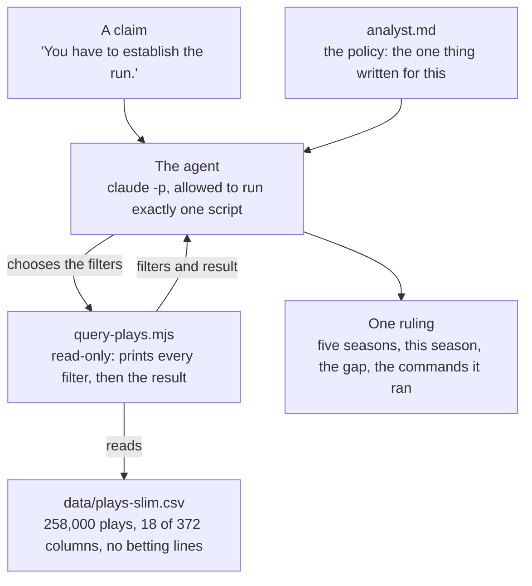
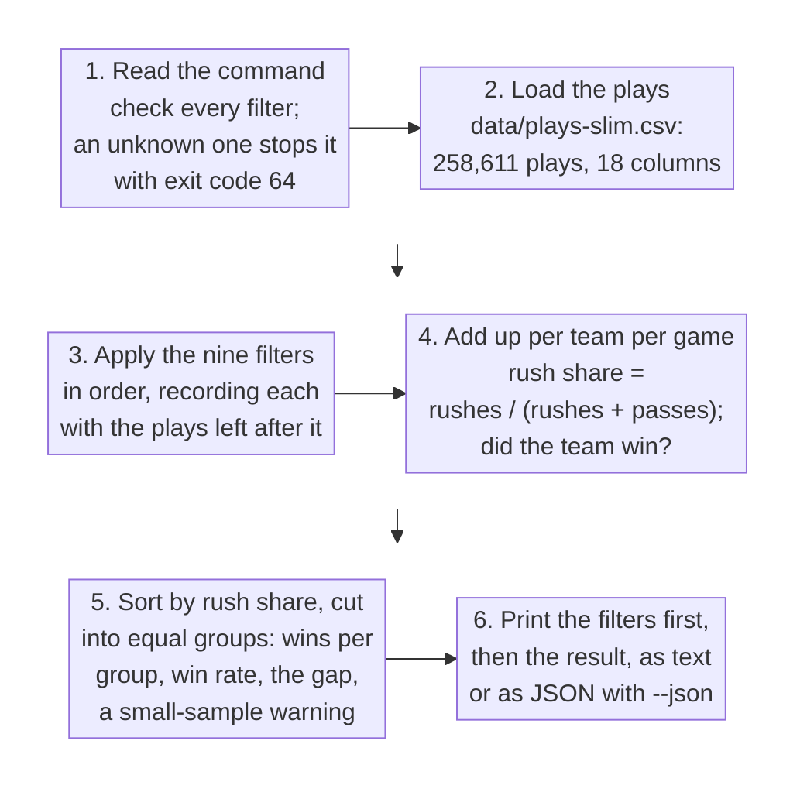
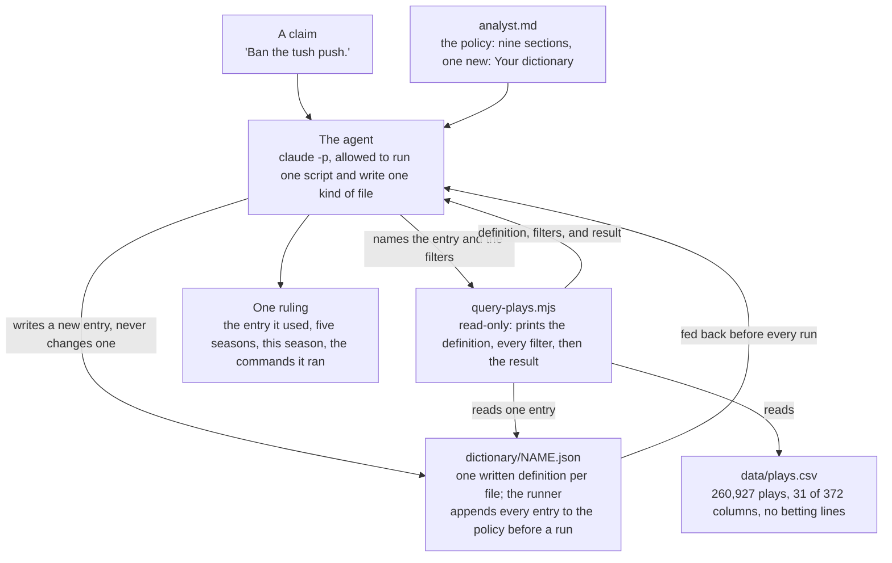

# The Monday Morning Agent

An agent that checks the tape. A football argument goes in; a ruling comes out, with
every filter it applied on screen.

This is the repo behind [The Monday Morning Agent](https://www.oreilly.com/live-events/the-monday-morning-agent/0642572456054/),
an eight-episode O'Reilly live series hosted by Chester Ismay. Each episode settles one
argument NFL fans cannot stop having and adds one skill to the agent. The series page
is https://ismayc.github.io/monday-morning-agent/.

## The eight episodes

One folder per episode, `episode-N/`, holding everything the agent ran on: the policy,
the tool, the data, the runner, and real output. One page folder per episode under
`docs/episode-N/`. The dictionary the agent writes from episode 2 on sits at the root,
[`dictionary/`](dictionary/), because every later episode cites it.

| # | The argument | Airs | The capability, in the registration page's words | What that means here | Where |
|---|---|---|---|---|---|
| 1 | "You have to establish the run." | October 12, 2026 (aired; [recording and recap](https://www.oreilly.com/radar/building-an-ai-analyst-one-football-argument-at-a-time/), [Substack](https://oreillyradar.substack.com/p/building-an-ai-analyst-one-football)) | Transparent queries | One agent, one read-only tool, every filter on screen | [`episode-1/`](episode-1/), [page](https://ismayc.github.io/monday-morning-agent/episode-1/) |
| 2 | "Ban the tush push." | October 26, 2026 | Shared data definitions as durable memory | A dictionary the agent writes and must cite from then on, and every later episode inherits | [`episode-2/`](episode-2/), [page](https://ismayc.github.io/monday-morning-agent/episode-2/) |
| 3 | "Kickers are too good now." | November 9, 2026 | Consistent visualizations | Written rules for its charts: a standard the renderer enforces, drawn only from rows the tool printed, and every later episode inherits | [`episode-3/`](episode-3/), [page](https://ismayc.github.io/monday-morning-agent/episode-3/) |
| 4 | The pundit audit, claim chosen by the room | November 23, 2026 | Independent fact-checking | A second agent as a standing fact-checker; the room votes on the claim in episode 3's Q&A | with the episode |
| 5 | "Coaches are cowards on fourth down." | December 7, 2026 | Operational boundaries | A written line it describes up to and declines to cross: no predictions | with the episode |
| 6 | The mailbag, from the previous Q&A | January 11, 2027 | Request triage | Working a queue of vague requests it did not choose, from episode 5's Q&A | with the episode |
| 7 | The agent writes its own column | January 25, 2027 | Self-directed analysis | Choosing its own questions, checked before it ships | with the episode |
| 8 | Two weeks unattended | February 8, 2027 | Scheduled autonomy | Running on a schedule, where the refusals matter more than the answers | with the episode |

The registration page also promises three things across the season: connecting an agent to
real data and turning a plain question into reproducible analysis (episodes 1 and 2),
making it reliable by validating its output, enforcing guardrails, and knowing when to
refuse (the runner's checks from episode 1 on, the declines in every episode, the boundary in
episode 5), and moving from copilot to autonomy through memory, triage, self-directed
analysis, and scheduled work (episodes 2, 6, 7, and 8). Nothing in it predicts a game or
touches a betting line.

Every page has the same strip across the top, which stays put as you scroll, and a term
with a dotted underline shows its definition on hover and links to that episode's
glossary. Each episode's section below starts with its pages.

## Episode 1: "You have to establish the run."

One agent, one read-only data tool, every filter shown. Everything is in `episode-1/`.

### The pages

- **The short version with no code:** https://ismayc.github.io/monday-morning-agent/episode-1/
- **The plays, row by row, and the cut from 372 columns to 18:** https://ismayc.github.io/monday-morning-agent/episode-1/plays.html
- **Change a filter yourself, nothing to install:** https://ismayc.github.io/monday-morning-agent/episode-1/explorer.html
- **How the one tool works, as a diagram:** https://ismayc.github.io/monday-morning-agent/episode-1/tool.html
- **Where we are, the episode in eight parts:** https://ismayc.github.io/monday-morning-agent/episode-1/map.html
- **Five meanings of the claim, one per keypress:** https://ismayc.github.io/monday-morning-agent/episode-1/meanings.html
- **The words the count uses (team-game, rush share, gap, and the rest):** https://ismayc.github.io/monday-morning-agent/episode-1/#terms
- **Appendix, the season sheets (not reached on air):** [five seasons](https://ismayc.github.io/monday-morning-agent/episode-1/season-sheet-2021-2025.html) and [this season](https://ismayc.github.io/monday-morning-agent/episode-1/season-sheet-2026.html)

### The kit



| File | What it is |
|---|---|
| `analyst.md` | The policy: eight sections, about 1,000 words. Who the agent is, its one tool, how to turn a claim into a question, answer it twice, show every filter, what it may not say, the shape of the ruling, the allowlist |
| `analyst-outline.md` | The same file with only its eight headings: what the episode starts from and fills in on air, and the place to start your own |
| `query-plays.mjs` | The one tool. Sorts every team's game by the share of its plays that were runs, cuts them into equal groups, and reports each group's win rate under the filters given. `node ./query-plays.mjs --help` lists the filters |
| `run-analyst.sh` | The runner: `claude -p` with your claim as the prompt, the policy as the system prompt, and a one-line allowlist. It also holds the policy's word limit: a ruling over 350 words above the commands goes back to the model once with "shorten it", and if it is still over, the run fails with an OVER LIMIT line |
| `show-run.mjs` | Turns the agent's event stream into what you see: each tool call with its filters and result as it lands, then the ruling |
| `render-run.mjs` | Writes the same run as one page, `rulings/run-<stamp>.html`: the ruling first, then each call down a clock with its filters as a funnel and its result as a table and a bar. The runner opens it when the run ends; `node ./render-run.mjs rulings/run-<stamp>.jsonl` rebuilds it for an older run |
| `season-sheet.mjs` | The answer on one page: asks the tool nine questions for a set of seasons (whole game, each half, the first half of games close at halftime, close games, the regular season, the playoffs) and writes them as one sheet with a verdict on the claim, by a rule printed on the page. `--seasons 2026` for this season, `--open` to open it, `--out` to put it anywhere. Written to `rulings/` by default, so a sheet is not public until it is published on purpose |
| `data/plays-slim.csv` | The plays: 2021 through 2025 complete, 2026 as far as it has been published |
| `slim-data.mjs`, `fetch-data.sh` | How that file is made: download the seasons from nflverse, keep 18 columns |
| `fetch-espn.mjs` | The fallback for this season: when nflverse has not yet published a game that has been played, fills it from ESPN's game summaries in the same 18 columns, and only until nflverse has it. `fetch-data.sh` runs it; `--check` only reports |
| `build-explorer-data.mjs` | Asks the tool every question the explorer page's buttons can ask and saves the answers |
| `build-plays-data.mjs` | Describes the plays file for the page that reads it: every column in the download with the kept ones and the betting lines marked, the counts, and every play of the latest week's games |
| `examples/` | A tool read (text and JSON), the policy, one run as it looked on screen, and three rulings: the episode's claim, a bet it declined, and a claim the tool cannot answer. The run and the first two rulings are from the episode on October 12, 2026 |
| `rehearse.sh` | `tool`, `claims`, `verify`, `freeze`: the rehearsal beats as subcommands |
| `show.sh` | The commands the episode typed on air, one word each, for rerunning it from this folder: `columns`, `tool`, `verify`, `run "<claim>"`, `sheets`. Each prints the real line before it runs it. Added after the show; episode 1 aired with the long commands typed by hand |

### How `query-plays.mjs` works

It is 224 lines of JavaScript (an ES module, hence `.mjs`), run by Node.js. It imports
only what ships with Node (`node:fs`, `node:path`, `node:url`), so there is nothing to
install. It reads one file and prints; it never writes and never goes online.



For `--seasons 2021-2025 --half 1`, stage 3 goes from 258,611 plays to 87,209; stage 4
finds 2,840 team-games; stage 5 cuts them into four groups of 710. The page linked above
follows that command through every stage.

### Run it

You need Node, git, and the [Claude Code CLI](https://claude.com/claude-code), signed in.
The data is in the repo.

```
git clone https://github.com/ismayc/monday-morning-agent.git
cd monday-morning-agent/episode-1

# the tool on its own: whole game, then first half only
node ./query-plays.mjs --seasons 2021-2025
node ./query-plays.mjs --seasons 2021-2025 --half 1

# the agent, with any claim about running the ball
./run-analyst.sh "You have to establish the run."
```

A run takes about 15 seconds and makes five tool calls for that claim. The ruling is
saved under `rulings/`, and the whole run opens in your browser as one page when it
ends (`ANALYST_NO_OPEN=1` writes the page without opening it). A ruling that runs over
the policy's 350 words goes back to the model once, and the page then shows both
versions. To refresh this season yourself: `./fetch-data.sh 2026`.

### What the numbers say

Five seasons, the teams that ran most against the teams that ran least:

| Filter | Ran most | Ran least | Gap |
|---|---|---|---|
| Whole game | 77.7% | 19.2% | 58.6 points |
| First half only | 53.0% | 46.1% | 6.9 points |
| Second half only | 87.0% | 11.7% | 75.4 points |
| First half, games within 3 points at halftime | 46.3% | 55.3% | -9.0 points |

Running early and running late tell two different stories, and holding the halftime
score close tells a third. Across all games, running early goes with a small edge. Hold
the halftime score within 3 points and the edge turns to -9.0: the teams that ran least
early won more. Running late goes with an enormous gap, and teams that are ahead run to
use the clock. The agent ruled on October 12, 2026 that the claim does not hold; its
ruling is in `examples/05-ruling.md`, and the evidence is on two season sheets,
[five seasons](https://ismayc.github.io/monday-morning-agent/episode-1/season-sheet-2021-2025.html)
and [this season](https://ismayc.github.io/monday-morning-agent/episode-1/season-sheet-2026.html).
One filter changes the story, which is why the tool prints every filter and the policy
makes the agent read them.

## Episode 2: "Ban the tush push."

The play nobody can stop arguing about has no name in the data: not one of 260,927
play descriptions, 2021 through the 2026 games of October 11, contains the words "tush
push." So the agent has to define the play before it can judge it. It writes the
definition into a dictionary at the root of this repo, the tool measures only by a
written entry, and every ruling cites the entry it used. Everything else is in
`episode-2/`.

### The pages

- **The short version with no code:** https://ismayc.github.io/monday-morning-agent/episode-2/
- **Change the definition of the play yourself, nothing to install:** https://ismayc.github.io/monday-morning-agent/episode-2/explorer.html
- **How the tool works, the dictionary included:** https://ismayc.github.io/monday-morning-agent/episode-2/tool.html
- **Where we are, the episode in eight parts:** https://ismayc.github.io/monday-morning-agent/episode-2/map.html
- **Five definitions of the tush push, one per keypress:** https://ismayc.github.io/monday-morning-agent/episode-2/definitions.html
- **The words (the defined play, primary passer, entry, cite, and the rest):** https://ismayc.github.io/monday-morning-agent/episode-2/#terms
- **The dictionary, the definitions the agent measures with:** [`dictionary/`](dictionary/)
- **Appendix, the season sheets (not reached on air):** [five seasons](https://ismayc.github.io/monday-morning-agent/episode-2/season-sheet-2021-2025.html) and [this season](https://ismayc.github.io/monday-morning-agent/episode-2/season-sheet-2026.html)

### The kit



| File | What it is |
|---|---|
| `analyst.md` | The policy: nine sections, about 1,400 words. Episode 1's eight plus "Your dictionary," third: search by name first, use an entry on file and never change it, write one when there is none, and cite it. The ruling has eight parts, the new one **Definition used**, under 400 words above the commands |
| `analyst-outline.md` | The nine headings and nothing else |
| `query-plays.mjs` | The one tool, 392 lines. `--search "WORDS" --seasons ...` counts the play descriptions containing the words, per season. `--play NAME --seasons ...` reads `dictionary/NAME.json`, prints it, applies the filters in order, and compares the defined play with every other rush with the same yards to go: plays, converted, rate, and the gap. With no entry of that name it stops with exit code 65 and prints the shape of one. `node ./query-plays.mjs --help` lists every flag |
| `run-analyst.sh` | The runner: `claude -p` with your claim, the policy plus the dictionary as the system prompt, and a two-line allowlist (`Bash(node ./query-plays.mjs:*)` and `Edit(//<repo>/dictionary/*.json)`). It holds the word limit as in episode 1, and adds three memory checks: the dictionary appended before the run, the citation required after it (exit 69 if still missing after one retry), and any entry that was on file and changed put back (exit 70); a new entry the tool rejects fails the run (exit 71). `ANALYST_DICT_DIR` points it at another dictionary folder |
| `show-run.mjs` | The live view: each tool call with its definition, filters, and result, each entry written shown in full, the ruling at the end |
| `render-run.mjs` | The run as one page, `rulings/run-<stamp>.html`: the ruling and the entry it cites at the top, then a search's count per season, an entry written, and each comparison with its filter funnel, its bar, and its table |
| `season-sheet.mjs` | The answer on one page: the name search, the entry quoted, nine situations as bars, by season and by team, and a verdict by a rule printed on the page. Written to `rulings/` by default |
| `data/plays.csv` | The plays: 2021 through 2025 complete, 2026 as far as it has been published, 31 columns with the play description last |
| `slim-data.mjs`, `fetch-data.sh` | How that file is made, from the raw seasons episode 1 downloads, so nothing is downloaded twice |
| `build-explorer-data.mjs` | Writes the explorer page's 54 definitions into a scratch dictionary, measures each for seven sets of seasons, and saves the answers |
| `examples/` | The search by name, the tool refusing with no entry, the policy, and from the episode on October 26, 2026: the run as it looked on screen, its ruling, the entry the agent wrote, and a claim it declined |
| `rehearse.sh` | `entry`, `tool`, `claims`, `verify`, `freeze`, `reset`: the rehearsal beats as subcommands, all writing into `rehearsal-runs/`, never into `../dictionary` |
| `show.sh` | The on-air commands, one word each: `search "<term>" [flags]`, `refuse`, `verify`, `run "<claim>"`, `sheets`, `prove "<claim>"`. Each prints the real tool line before it runs it, and `ANALYST_DICT_DIR` passes through |

### The dictionary

[`dictionary/`](dictionary/) holds the written definitions the agent measures with, one
JSON file per entry: a name, the day it was written, the definition in plain words,
four rules the data can apply (who carried, the yards to go, shotgun or not, the downs),
what it is compared with, and what it cannot see. The agent may add an entry and may
never change one; a different definition is a new entry with a new name. It sits at the
root, not in `episode-2/`, because every later episode that measures a play cites it.
Its [README](dictionary/README.md) gives the shape and every key. Its first entry,
`tush-push`, was written on air on October 26, 2026, and is committed as written.

### Run it

```
cd monday-morning-agent/episode-2

# the search by name
node ./query-plays.mjs --search "tush push" --seasons 2021-2026

# a play with no entry: the tool stops and prints the shape of one
node ./query-plays.mjs --play no-such-play --seasons 2021-2025

# the agent, into a scratch dictionary so your copy of the real one stays as it is
ANALYST_DICT_DIR=$(mktemp -d) ./run-analyst.sh "Ban the tush push."
```

With an empty dictionary a run takes under a minute: it searches by name, gets the
tool's refusal, writes the entry, measures with it, and cites it. Leave out
`ANALYST_DICT_DIR` and the agent reads and writes the repo's own `dictionary/`.

### What the numbers say

Measured with the entry the agent wrote on air (a run by the primary passer, one yard or
less to go, under center, any down), the play converts more often than every other rush
at that distance, and not only in Philadelphia. The agent's ruling on air: "The claim
does not hold in its strong form: the defined play converted 8.3 points more often than
other short-yardage rushes over five seasons and 7.8 points more without PHI, which is a
real edge but not a gap that makes it a different kind of play."

| 2021 to 2025 | The defined play | Every other rush at that distance | Gap |
|---|---|---|---|
| All downs | 78.3% of 1,472 | 70.0% of 6,282 | 8.3 points |
| Third and fourth down | 82.9% of 1,149 | 70.1% of 3,515 | 12.8 |
| Every team but the Eagles | 77.9% of 1,299 | 70.1% of 6,134 | 7.8 |
| The Eagles only | 80.9% of 173 | 65.5% of 148 | 15.4 |

All nine situations, with a verdict by a rule printed on the page, are on the
[five-season sheet](https://ismayc.github.io/monday-morning-agent/episode-2/season-sheet-2021-2025.html),
which ends with the ruling, and the
[2026 sheet](https://ismayc.github.io/monday-morning-agent/episode-2/season-sheet-2026.html)
asks the same questions of this season (through the October 25 games: 82.0% of 128
against 67.7% of 477, a gap of 14.3 points). The episode did not reach the sheets on
air, so the episode page carries them as an appendix. The tool's numbers for 54
definitions of the play, this one among them, are on
[the explorer page](https://ismayc.github.io/monday-morning-agent/episode-2/explorer.html).

## Episode 3: "Kickers are too good now."

Every field goal in six seasons went through 84 to 86 percent of the time, and a chart
can make that climb a mountain or lie flat, depending on where it starts. A claim about
a trend needs a picture, and a picture is a set of choices: which seasons, where the axis
begins, which line gets the bright color. So this episode the agent gets written rules
for its charts, in a standard at the root of this repo, and it does not draw: it writes
a spec naming the question and the command, and a renderer draws the rows the tool
printed, under the standard, or refuses with the rule named. The dictionary gains a
second shape, a kick, and the tool a third question, a trend. Everything else is in
`episode-3/`.

### The pages

- **The short version with no code:** https://ismayc.github.io/monday-morning-agent/episode-3/
- **The chart standard, one rule per keypress, with the pictures:** https://ismayc.github.io/monday-morning-agent/episode-3/standard.html
- **The vote for episode 4, four claims and no numbers:** https://ismayc.github.io/monday-morning-agent/episode-3/vote.html
- **The words (the defined kick, the trend, the spec, the renderer, and the rest):** https://ismayc.github.io/monday-morning-agent/episode-3/#terms
- **The chart standard as a file, and the renderer:** [`charts/`](charts/)
- **The dictionary, both shapes:** [`dictionary/`](dictionary/)
- **Appendix, the season sheets:** published after the show, with the entry the agent writes on air

### The kit

| File | What it is |
|---|---|
| `analyst.md` | The policy: ten sections, about 1,700 words. Episode 2's nine plus "Your charts," fourth, and rule 4 in "Your dictionary" for plays neither shape can express. The ruling has nine parts, the new one **Chart**, under 500 words above the commands |
| `analyst-outline.md` | The ten headings, one line each |
| `query-plays.mjs` | The one tool. Episode 2's `--search` and `--play`, plus `--trend NAME --seasons ...`, which reads a kick entry and prints one row per season: the defined kick's attempts, made, rate, and tries per game, every other attempt's rate, and the gap; `--bands` adds the four distance bands; the season still being played is flagged IN PROGRESS. `node ./query-plays.mjs --help` lists every flag |
| `run-analyst.sh` | The runner: `claude -p` with your claim; the policy, the dictionary, the standard, and the specs on file as the system prompt; and a four-line allowlist (the tool, the renderer, `Edit(//<repo>/dictionary/*.json)`, `Edit(//<repo>/charts/*.json)`). Episode 2's checks, plus: a run that measured a trend must cite a chart that was drawn (exit 72 after one retry); specs are snapshotted and restored like entries (70); a new spec the renderer refuses fails the run (71). `ANALYST_DICT_DIR` and `ANALYST_CHART_DIR` point it at other folders |
| `show-run.mjs`, `render-run.mjs` | The live view and the run page. The page shows a spec written, the render call with the rules it checked and the chart inline, and a trend's season table |
| `season-sheet.mjs` | The appendix: six situations as season tables, the chart drawn by the renderer, and a verdict by a rule printed on the page. The 2026 sheet reads this season against the five-season baseline |
| `bad-chart.json` | The spec the renderer refuses on air: the same question with the trend starting in 2023, rule 1 |
| `data/plays.csv` | The plays: 2021 through 2025 complete, 2026 as far as it has been published, 35 columns, four of them about kicks |
| `slim-data.mjs`, `fetch-data.sh` | How that file is made, from the raw seasons episode 1 downloads |
| `rehearse.sh` | `entry`, `tool`, `claims`, `verify`, `freeze`, `reset`: the rehearsal beats, all writing into `rehearsal-runs/`, never into `../dictionary` or `../charts` |
| `show.sh` | The on-air commands, one word each: `search`, `trend`, `refuse`, `verify`, `run "<claim>"`, `sheets`, `prove "<claim>"` |

### The chart standard

[`charts/`](charts/) holds [`STANDARD.md`](charts/STANDARD.md), eight rules for every
chart the agent draws (the window, the axes, the counts, the colors, the title, the
source line, what may appear, and the template), and [`render-chart.mjs`](charts/render-chart.mjs),
which draws one SVG from one spec. The spec is a small JSON file the agent writes: a
name, a date, the question as the title, the tool, and the command, and nothing about
how to draw it. The renderer runs the command itself with `--json` and draws what comes
back, so a chart cannot carry a number the tool did not print; it checks the window
(rule 1) and the title (rule 5), fixes the rest by its template, and refuses a spec
that breaks a rule with the rule named, exit 65. It sits at the root because every
later episode's charts follow it. The [README](charts/README.md) gives the shape of a
spec. Specs written on air are committed after the show, with their SVGs.

### Run it

```
cd monday-morning-agent/episode-3

# the trend of every field goal, by distance band: the entry committed before the show
node ./query-plays.mjs --trend field-goal --seasons 2021-2026 --bands

# a kick with no entry: the tool stops and prints the kick shape
node ./query-plays.mjs --trend no-such-kick --seasons 2021-2026

# a spec that starts the trend in 2023: the renderer names rule 1 and draws nothing
node ../charts/render-chart.mjs ./bad-chart.json

# the agent, into scratch folders so your copies of the real ones stay as they are
ANALYST_DICT_DIR=$(mktemp -d) ANALYST_CHART_DIR=$(mktemp -d) ./run-analyst.sh "Kickers are too good now."
```

A run takes about half a minute: it searches by name, gets the tool's refusal, writes
the entry, reads the trend and the bands, writes the spec, renders it, and cites both.
The long-kick numbers and the ruling go here after the show.

## Across the episodes

### What this agent does not do

No predictions, no odds, no wagering analysis, and no fantasy advice. That is a design
decision. The public data carries betting-line columns; no episode's
`slim-data.mjs` keeps them, so no file the agent can reach has one.

### A scheduled workflow commits to `main`

`.github/workflows/refresh-data.yml` is scheduled three times a night (GitHub starts
scheduled workflows hours late, so one slot is not enough; the file says why). It
re-downloads the seasons once, rebuilds episode 1's slim file, explorer answers, and
plays-page data, then episode 2's plays file and explorer answers and episode 3's plays
file from the same downloads, and commits when the plays changed. Pull before you push.

### Data

Play-by-play data is from [nflverse](https://github.com/nflverse/nflverse-data),
licensed [CC BY 4.0](https://creativecommons.org/licenses/by/4.0/). Each episode keeps
its own cut of it, seasons 2021 through 2026: episode 1 keeps 18 of the 372 columns
(`episode-1/data/plays-slim.csv`), episode 2 keeps 31, the play description among them
(`episode-2/data/plays.csv`). nflverse rebuilds its file several times a day in season,
so a Sunday game is normally there by Monday morning; for the morning it is not,
episode 1's `fetch-espn.mjs` fills the missing games from ESPN's public game summaries
on your own machine (the committed files are nflverse only, and episode 2's file has no
ESPN fill at all). Measured on all 16 Week 4 games of 2026: the two sources agree on a
team's runs and passes within three plays, and on rush share within 1.15 points.

The site is `docs/`: the series page at the root, [the game explained](https://ismayc.github.io/monday-morning-agent/football.html)
for people who have never watched American football (`docs/football.html`, linked from
the top of the series page), and one folder per episode
(`docs/episode-1/`, `docs/episode-2/`), all sharing `docs/sheet.css` and the icons. The link-preview images
and the icons are rendered from the `og-image.html` beside each image and from
`docs/apple-touch-icon.html`; each file's first
comment has the command (serve `docs/` locally first, since the preview source loads
the stylesheet and fonts).
